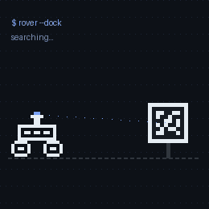

  

 

<table>
<tr>
<td width="64%" valign="top">

### `> hey, i'm nithin`

It's hard to tell you about myself in one paragraph, isn't it?
I'm just a kid exploring stuff. These days it's mostly **software for robots**, **system architecture** and **AI agents**.

- 🤖 &nbsp;**now:** software engineer, robotics: behavior trees, AprilTag positioning, MuJoCo / Webots simulation
- 🛞 &nbsp;**building:** perception & navigation for [Vulcan](https://nithin434.github.io/public/projects/vulcan.html), a self-driving campus EV at VIT-AP
- 📄 &nbsp;**published:** [IEEE AIRC 2026](https://doi.org/10.1109/AIRC69745.2026.11631384) · [IEEE iSAI-NLP 2025](https://doi.org/10.1109/ISAI-NLP66160.2025.11320726)
- 🌐 &nbsp;**everything else:** [nithin434.github.io](https://nithin434.github.io/)

</td>
<td width="36%" align="center" valign="middle">
  
</td>
</tr>
</table>

## `// open source`

## `// things i've built`

| | project | what it does |
|:-:|---|---|
| 🧠 | [**PatchPilot**](https://nithin434.github.io/public/projects/patchpilot.html) · [code](https://github.com/nithin434/code_review) | AI agents review pull requests for security, quality and logic, coordinated with LangGraph |
| 📚 | [**Context-Preserving RAG**](https://nithin434.github.io/public/projects/rag.html) · [code](https://github.com/nithin434/Context-Preserving) | source-backed answers from documents with hybrid vector + BM25 search |
| 🛰️ | [**AprilTag Docking Rover**](https://nithin434.github.io/public/projects/rover.html) · [code](https://github.com/nithin434/apriltag_rover) | a ROS 2 rover that finds and docks with its station on its own |
| 🚗 | [**Vulcan**](https://nithin434.github.io/public/projects/vulcan.html) | self-driving campus EV: DeepLabV3+, lane following, SAC/DAgger in CARLA, Jetson |
| 👓 | [**EchoSight**](https://nithin434.github.io/public/projects/echosight.html) | navigation glasses for the visually impaired, YOLOv8 at 45+ FPS on a Raspberry Pi (patent pending) |
| 🎬 | [**16fps**](https://nithin434.github.io/public/projects/16fps.html) | multi-agent video generation with consistent characters |
| 🔎 | [**MatriAI**](https://nithin434.github.io/public/projects/matriai.html) · [code](https://github.com/nithin434/matriAI) | semantic profile matching with FastAPI, LangChain, ChromaDB and MongoDB |
| 📦 | [**apk2abb**](https://pypi.org/project/apk2abb/) · [code](https://github.com/nithin434/apk2abb) | Python package on PyPI: APK → Play Store app bundle |

→ [all projects](https://nithin434.github.io/public/projects.html)

## `// toolbox`

             

## `// contributions`

  

 

   

